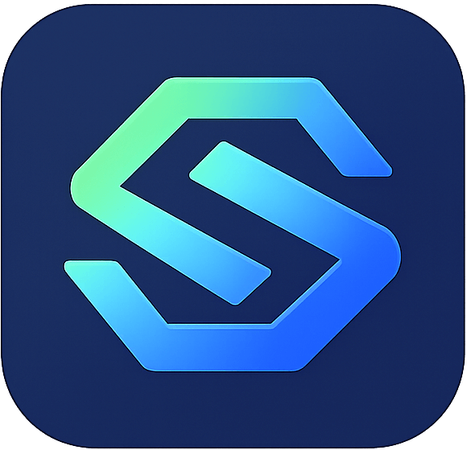

<p align="center">
  
</p>

<h1 align="center">无限画布 (infinite-canvas)</h1>

<p align="center">
  <a href="https://render.com/deploy?repo=https://github.com/Cc-kris/infinite-canvas"></a>
  <a href="https://github.com/Cc-kris/infinite-canvas"></a>
  <a href="https://github.com/Cc-kris/infinite-canvas/tags"></a>
  <a href="LICENSE"></a>
  <a href="https://vite.dev/"></a>
  <a href="https://reactrouter.com/"></a>
</p>

<p align="center">
  <a href="docs/content/docs/overview/quick-start.mdx">快速开始</a> · <a href="docs/content/docs/overview/features.mdx">功能介绍</a> · <a href="docs/content/docs/overview/render.mdx">Render 部署</a> · <a href="docs/content/docs/overview/docker.mdx">Docker 部署</a> · <a href="docs/content/docs/canvas/canvas-node-manual.mdx">画布节点操作手册</a> · <a href="docs/content/docs/canvas/canvas-shortcuts.mdx">画布快捷键</a> · <a href="SECURITY.md">漏洞提交</a> · <a href="docs/content/docs/progress/todo.mdx">待办事项</a> · <a href="canvas-agent/README.md">本地 Canvas Agent</a> · <a href="plugins/infinite-canvas">Codex app 插件</a>
</p>

无限画布是一款面向图片创作的开源工作台。它把画布编排、AI 图片生成、参考图编辑、对话助手、提示词库和素材沉淀放在同一个界面里，适合用来探索视觉方案并连续迭代图片结果。

## 关于本项目

本项目是开源项目 [basketikun/infinite-canvas](https://github.com/basketikun/infinite-canvas) 的**二次开发（fork）版本**，并非由原作者维护：原项目作者开发了画布、生图、插件等核心能力，本仓库在其代码基础上继续做了桌面端、本地 Agent 接入与网络连通性方面的改造，并在两套代码间持续对齐上游更新。

- 原项目：<https://github.com/basketikun/infinite-canvas>（MIT License，原始版权归原作者所有）
- 本仓库：<https://github.com/Cc-kris/infinite-canvas>（同样采用 MIT License，见 [LICENSE](LICENSE)）

> [!CAUTION]
> 项目目前处于开发阶段，不保证历史数据兼容，各种本地存储格式都可能直接调整。

### 与原项目的差异

- **桌面版（Electron）**：提供 macOS（arm64 / x64 dmg）与 Windows（x64 安装包）一键安装包，内置固定端口的本地静态服务与本地代理，开箱即可使用；支持应用内检查更新、静默覆盖升级。
- **本地 Agent Hub**：一键连接 Claude Code / Codex / Galley 三种本地 Agent，自动拉起内置 Agent 服务并安装 MCP 插件，可在面板内切换运行时、手动指定安装目录。
- **网络连通性改造**：`canvas-proxy` 改为出站双通道（系统代理失败自动回退直连），修复国内网络下 `fetch failed`、生图超时、更新检查静默失败等问题。
- **一批平台修复**：Windows 原生菜单与安装/自更新、macOS 编辑菜单（⌘C/⌘V）、远程桌面下点击卡顿、Agent 连接互斥与卡「连接中」等。
- **界面细节**：运行时文案按当前 Agent 动态显示（不再硬编码 Codex），补充 logo 与图标资源。

## 赞助商

<table>
  <tr>
    <td width="190" align="center">
      <a href="https://cc-ai.xyz" target="_blank" rel="noopener noreferrer"></a>
    </td>
    <td>
      <strong><a href="https://cc-ai.xyz" target="_blank" rel="noopener noreferrer">CCAI（cc-ai.xyz）</a></strong> 赞助了本项目。CCAI 是一个面向开发者的大模型聚合平台，兼容 OpenAI 协议，一个 API Key 即可调用多家主流模型：在无限画布右上角的配置里把 <code>Base URL</code> 填成 <code>https://cc-ai.xyz/v1</code>、填入自己的 Key，就能直接开始生图与对话，无需自建中转。按量计费，适合在画布里混合调用多家模型做连续创作与批量出图。
    </td>
  </tr>
</table>

## 核心功能

- 无限画布：多画布项目、节点拖拽缩放、连线、小地图、撤销重做、导入导出。
- AI 创作：浏览器前台直连你配置的 OpenAI 兼容接口，支持文生图、图生图、参考图编辑、文本问答、音频和视频生成。
- 画布助手：围绕选中节点和上游节点对话、生图，并把结果插回画布。
- 本地 Agent：通过本机 Canvas Agent 连接 Codex / Claude Code / Galley，让 Agent 通过 MCP 操作当前画布。
- Codex App 插件：提供 Codex app 插件，安装后会自动注册 MCP 并尝试拉起本地 Agent。
- 插件系统：支持通过 URL 动态安装 / 启用 / 更新 / 卸载远程节点插件，并提供 TypeScript SDK 自行开发画布节点插件。
- 自定义接口调用：可自定义生图 / 视频接口的调用方式，灵活适配各类中转站与自建服务。
- 提示词库：内置 7 个开源提示词来源并支持自定义标准 JSON 来源，由浏览器前端直连并缓存到 IndexedDB。

完整功能说明见 [功能介绍](docs/content/docs/overview/features.mdx)。

## 快速开始

AI API Key、Base URL、画布、素材和生成记录默认保存在浏览器本地。

### 本地开发

```bash
git clone https://github.com/Cc-kris/infinite-canvas.git
cd infinite-canvas
cd web
bun install
bun run dev
```

### Docker 运行

```bash
git clone https://github.com/Cc-kris/infinite-canvas.git
cd infinite-canvas
docker compose up -d
```

运行后默认端口 3000，可访问 `http://localhost:3000`。

首次打开后进入右上角配置，填入自己的 OpenAI 兼容 `Base URL` 和 `API Key`（例如赞助商 CCAI 的 `https://cc-ai.xyz/v1`）。

如果默认的 OpenAI 接口调用方式与你的 API 不同，可自定义生图/视频脚本调用。

### 桌面版

桌面版安装包随版本发布在 [Releases](https://github.com/Cc-kris/infinite-canvas/releases) 页面，macOS / Windows 均为未签名包，首次打开需按发布说明里的步骤手动放行。

## 效果展示

<table width="100%">
  <tr>
    <td width="50%"></td>
    <td width="50%"></td>
  </tr>
  <tr>
    <td width="50%"></td>
    <td width="50%"></td>
  </tr>
  <tr>
    <td width="50%"></td>
    <td width="50%"></td>
  </tr>
  <tr>
    <td width="50%"></td>
    <td width="50%"></td>
  </tr>
</table>

## 反馈

问题、建议、二开讨论请直接开 [GitHub Issue](https://github.com/Cc-kris/infinite-canvas/issues)；安全问题请按 [SECURITY.md](SECURITY.md) 的说明提交。

## 开源协议

本项目使用 [MIT License](LICENSE)。任何人都可以免费使用、复制、修改、分发、再授权和商业使用本项目，也可以用于闭源产品。
