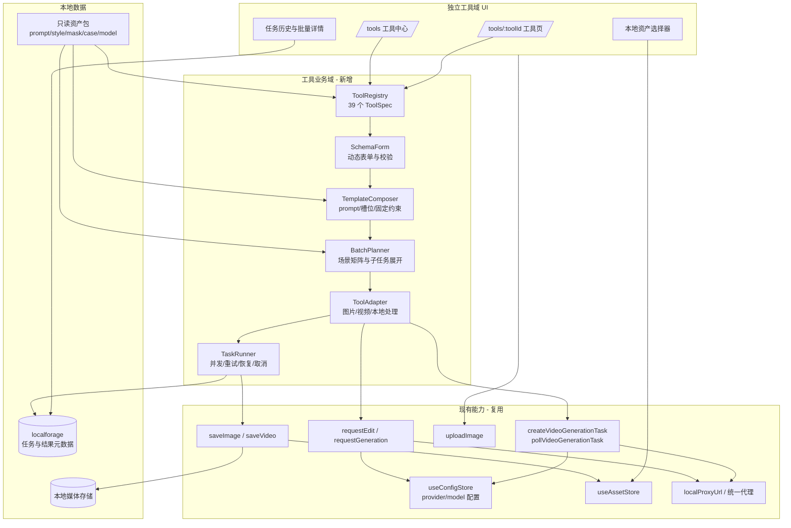
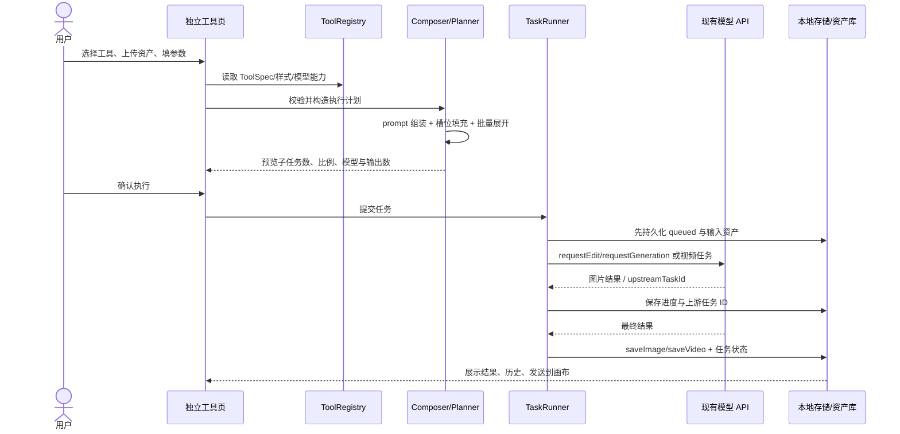

# LinkFox 图片 / 视频复刻｜V1.0 架构蓝图

> 文档状态：**V1.0 实施基线**  
> 适用仓库：`infinite-canvas`  
> 对应方案：[01-replica-plan-v1.0.md](./01-replica-plan-v1.0.md)  
> 资产索引：[assets/README.md](./assets/README.md)  
> 核心约束：**39 个工具、独立功能页、非画布节点、纯前端业务编排、复用现有模型与本地资产能力**

---

## 1. 架构目标与边界

### 1.1 目标

1. 在现有 `/image`、`/video` 页面之外新增 `/tools` 工具中心，不改画布节点模型。
2. 用一套 `ToolSpec + ToolAdapter + TaskRunner` 支撑 39 个工具，避免 39 套独立提交、轮询、存储逻辑。
3. 把已抓取的 prompt、蒙版、样式、场景矩阵、案例、模型能力转换为本地只读资产包。
4. 图片、视频、历史记录、发送到画布在 Web 与 Desktop 使用同一业务实现。
5. 原站只作为取证与验收参照；产品运行时不访问 LinkFox、不携带其鉴权或积分体系。

### 1.2 不做

- 不做选品、关键词、Listing、会员、积分、算力包和团队审批。
- 不自建 LinkFox 式业务后端，不复制 AES 信封到产品运行时。
- 不承诺跨供应商逐像素一致；承诺功能、输入、参数、模板、任务与结果链路等价，并用案例 A/B 验证质量。
- 不把 39 个工具塞进一个通用表单的 if/else，也不复制 39 份页面。

---

## 2. 总体架构



### 2.1 最关键的分层原则

| 层 | 负责 | 不负责 |
|---|---|---|
| 页面层 | 布局、交互、资产选择、进度展示 | 拼 prompt、直接请求模型 |
| 工具契约层 | 字段、默认值、样式、模型能力、输出类型 | React 状态、网络 |
| 编排层 | 模板组装、批量展开、参数映射 | 页面组件、媒体存储 |
| 执行层 | 图片/视频调用、轮询、重试、恢复 | 工具专属 UI |
| 资产层 | 本地文件、任务元数据、结果入库 | 模型参数推断 |

---

## 3. 与现有仓库的落点

已核实现有入口：`web/src/router.tsx` 使用 React Router；`web/src/pages/image`、`web/src/pages/video` 已有生成页；`web/src/services/api/image.ts`、`video.ts` 已有统一调用；`useAssetStore` 与 `localforage` 已存在。

### 3.1 新增目录

```text
web/src/
├─ pages/tools/
│  ├─ index.tsx                    # 工具中心
│  ├─ tool-page.tsx                # 动态工具页外壳
│  └─ task-detail.tsx              # 批量/视频任务详情
├─ components/tools/
│  ├─ tool-catalog.tsx
│  ├─ schema-form.tsx
│  ├─ input-asset-picker.tsx
│  ├─ style-picker.tsx
│  ├─ mask-editor.tsx
│  ├─ batch-scene-editor.tsx
│  ├─ task-progress.tsx
│  └─ result-grid.tsx
├─ services/tools/
│  ├─ registry.ts                  # 39 工具注册与查询
│  ├─ types.ts                     # ToolSpec/Task/Result 类型
│  ├─ schemas/                     # 每族一个 schema，不建 39 套执行器
│  ├─ templates/
│  │  ├─ composer.ts
│  │  ├─ constraints.ts
│  │  └─ slot-filler.ts
│  ├─ adapters/
│  │  ├─ image.ts
│  │  ├─ video.ts
│  │  ├─ local-transform.ts
│  │  └─ index.ts
│  ├─ batch-planner.ts
│  ├─ task-runner.ts
│  ├─ task-store.ts
│  ├─ asset-repository.ts
│  └─ result-service.ts
├─ stores/use-tool-task-store.ts   # 仅内存 UI 状态；持久化走 task-store
└─ assets/tools/v1/                # 构建后只读、按族拆包
   ├─ manifest.json
   ├─ tools/*.json
   ├─ prompts/*.json
   ├─ styles/*.json
   ├─ models/*.json
   └─ examples/*.json
```

### 3.2 修改点保持最小

| 现有文件 | 修改 |
|---|---|
| `web/src/router.tsx` | 懒加载 `/tools`、`/tools/:toolId`、`/tools/tasks/:taskId` |
| `web/src/layouts/user-layout.tsx` | 增加“AI 工具”入口，不改变现有导航顺序的其余项 |
| `web/src/i18n/*` | 工具中心与公共字段文案；39 工具文案从资产 14 整理 |
| `web/src/services/api/*` | 原则上不改；确缺能力时新增薄封装，禁止绕过统一客户端 |
| `useAssetStore` | 复用；结果入库后由现有资产页与画布选择器读取 |

**禁止**把工具任务状态塞进画布 store；只有用户点击“发送到画布”时才创建普通图片/视频节点。

---

## 4. 核心契约设计

### 4.1 ToolSpec

```ts
type ToolKind = "image" | "video" | "batch-image" | "local";
type PromptSource = "payload" | "style" | "slot-template" | "reference" | "parameters";

interface ToolSpec {
  id: string;                    // 如 PRODUCT_SCENE；本地稳定 ID
  sourceType?: number;           // 仅作原站数据对照，不发往模型
  nameKey: string;
  kind: ToolKind;
  promptSource: PromptSource;
  fields: FieldSpec[];           // 由资产 09 转换
  inputAssets: InputAssetSpec[]; // 商品图、蒙版、参考视频等
  styles?: StyleAssetRef;
  models: ModelCapabilityRef[];  // 由资产 08 转换
  defaults: Record<string, unknown>;
  adapter: "image" | "video" | "local";
  output: OutputSpec;
  exampleSet?: string;
}
```

### 4.2 六族共用，不为每工具写执行器

| 执行族 | 工具特征 | 共用逻辑 |
|---|---|---|
| 单图/多图生成 | prompt + 比例 + 数量 | `image` adapter |
| 蒙版/局部编辑 | 输入图 + 区域 + 参数 | `image` adapter + mask composer |
| 参数变换 | 裁剪、拼接、翻译等 | 本地或模型适配器，按真实能力选择 |
| 批量套图 | 场景勾选 + 每场景数量 | `BatchPlanner` 展开为独立子任务 |
| 视频生成 | 图/视频 + 时长 + 镜头等 | `video` adapter + 持久轮询 |
| 复合输入 | 商品 + 模特 + 蒙版 + 文案 | 输入组合器 + 图片/批量执行 |

### 4.3 统一任务模型

```ts
interface ToolTask {
  id: string;
  toolId: string;
  parentId?: string;             // 批量子任务指向父任务
  status: "draft" | "queued" | "running" | "succeeded" | "failed" | "cancelled";
  input: Record<string, unknown>;
  resolvedPrompt?: string;
  inputAssetIds: string[];
  outputAssetIds: string[];
  provider?: string;
  model?: string;
  upstreamTaskId?: string;       // 视频恢复轮询
  attempt: number;
  progress?: number;
  error?: { code: string; message: string; retryable: boolean };
  createdAt: number;
  updatedAt: number;
}
```

---

## 5. 运行时主链路



### 5.1 失败语义

- 校验失败：不创建任务，不调用模型。
- 上游 5xx：仅对明确可重试错误退避；不在 React render 中重试。
- 批量任务：子任务独立成功/失败；父任务显示 `成功 x / 失败 y / 取消 z`，不因一个失败回滚全部。
- 页面刷新：读取未完成任务；视频有 `upstreamTaskId` 则续轮询；没有上游 ID 的本地任务标为中断并允许人工重试。
- 重复点击：提交按钮在持久化前禁用；以任务 ID 防止重复入库。

---

## 6. Prompt 与资产装配

### 6.1 模板组装顺序

```text
用户输入/商品描述
  + 工具固有指令
  + 样式 prompt（可选）
  + 场景/姿势/视角原子（可选）
  + A+ 槽位填充结果（可选）
  + 比例、数量、语言、品牌参数（结构化参数优先）
  + 商品一致性与固定约束
  → ResolvedPrompt（随任务保存，便于复现）
```

| 资产 | 运行时用途 | 对应分册 |
|---|---|---|
| 案例库 | 示例与黄金 A/B，不自动把案例 prompt 当模板 | [资产 01](./assets/01-case-library.md) |
| 样式库 | 样式选择器与缩略图索引 | [资产 02](./assets/02-style-library.md) |
| 场景 Prompt | B 类正式模板，其他工具可选风格 | [资产 03](./assets/03-scene-prompt-pool.md) |
| 场景矩阵 | 套图/穿搭批量展开 | [资产 04](./assets/04-scene-matrix.md) |
| A+ 模板 | C 类槽位模板 | [资产 05](./assets/05-aplus-scene-templates.md) |
| 蒙版 | 与 styleId 绑定的编辑区域参考 | [资产 06](./assets/06-mask-assets.md) |
| 首帧/模特图 | 多图参考输入 | [资产 07](./assets/07-model-first-frame-assets.md) |
| 模型目录 | 能力路由和参数裁剪 | [资产 08](./assets/08-model-catalog.md) |
| 工具契约 | 表单与请求构造 | [资产 09](./assets/09-tool-schemas.md) |

### 6.2 模型语法适配

- 原样保存官方 prompt，运行时生成独立的 `resolvedPrompt`，不覆盖源资产。
- 对不支持 SD 权重语法的模型，剥离 `<lora:...>`；`(text:0.8)` 等权重需要适配器转换并记录警告。
- 蒙版 URL 只对应原样式参考图。新用户图必须重新分割或允许用户修蒙版，不能直接套用。
- 原站模型映射是能力参照，不伪称本地使用了同一个闭源模型。

---

## 7. 本地数据与资产包

### 7.1 资产包构建

原始 JSON/GZ 保留在 `docs/analysis/assets/linkfox/`，不直接打进前端 bundle。构建脚本执行：

1. 校验数量、必填字段、tool/type 对照和资源 URL。
2. 按工具/执行族拆包，生成 `manifest.json`（版本、hash、数量）。
3. prompt、模板、契约进入 `web/src/assets/tools/v1/`；案例和验收大文件留在开发数据集，不进入生产首屏。
4. 图片按用量懒加载；不在构建时批量下载第三方媒体。
5. 启动时校验 manifest，失败则阻止执行并提示资产包不完整。

### 7.2 存储分工

| 数据 | 存储 |
|---|---|
| 工具定义、prompt、样式元数据 | 前端只读资产包 |
| 任务、输入参数、resolvedPrompt、上游任务 ID | localforage 独立 store |
| 输入/输出图片与视频 | 现有本地媒体存储与 `saveImage` / `saveVideo` |
| 资产卡片与画布共享 | 现有 `useAssetStore` |
| 用户 provider/model/key | 现有配置体系，工具域不复制、不导出 |

---

## 8. 独立工具页的信息架构

```text
/tools
  工具分类、搜索、图片/视频筛选、最近使用
       ↓
/tools/:toolId
  ① 输入资产（商品图/蒙版/参考视频）
  ② 参数与样式（按 ToolSpec 渲染）
  ③ 模型与高级参数（按能力裁剪）
  ④ 执行预览（prompt 可折叠、子任务数、预计输出数）
  ⑤ 结果与历史（保存、重试、下载、发送到画布）
       ↓
/tools/tasks/:taskId
  批量网格、每个子任务状态、失败原因、单独重试
```

- 默认展示该工具必需字段；高级参数折叠，避免把 20 多个字段全部平铺。
- 视频任务与批量套图必须有独立详情页，不能只靠 toast。
- “发送到画布”是结果动作，不是工具运行方式。

---

## 9. 安全、隐私与合规

1. 产品运行时不携带 LinkFox authorization、Cookie、AES key 或用户积分信息。
2. 模型 key 继续由用户现有配置管理；日志、任务导出和分享默认剔除 key 与签名参数。
3. 官方案例只用于内部基准；生产示例需替换为自有/可授权素材。
4. 第三方图片 URL 可能带过期签名，资产包保存来源但运行时使用本地输入资产。
5. 失败日志保留 provider、HTTP 状态和脱敏消息，不记录完整敏感请求体。

---

## 10. 测试与验收架构

| 层 | 必测内容 |
|---|---|
| 契约测试 | 39 个 ToolSpec 均可加载；字段与资产 09 对齐；未知字段不静默丢失 |
| 模板测试 | 五类 prompt 来源各有快照；槽位无残留；固定约束只出现一次 |
| 编排测试 | `Σ num` 子任务数正确；批量部分失败；取消不继续派发 |
| 适配器测试 | 图片/视频参数映射；不支持的比例/分辨率被禁止 |
| 恢复测试 | 刷新后视频续轮询；中断任务可识别；结果不重复入库 |
| 资产测试 | 77 模板、1153 场景 prompt、878 蒙版 URL 等 manifest 数量匹配 |
| 黄金 A/B | 每工具至少 3 条；比较输入、prompt、参数、输出与人工质量结论 |
| 端到端 | `/tools` 独立使用，不创建画布节点；发送后才出现普通媒体节点 |

### V1.0 完成定义

- 39 个工具都可进入并有正确表单；不允许只有静态壳页面。
- 每个工具都有可执行适配器和至少一条真实模型链路验证记录。
- 图片、视频、批量、蒙版、模板五条主链路通过端到端验收。
- 资产包数量校验通过，模型/模板/输入可复现，任务刷新可恢复。
- 无 LinkFox 运行时依赖，无积分/选品功能，无强制画布节点耦合。

---

## 11. 实施顺序

| 阶段 | 架构交付 | 出口条件 |
|---|---|---|
| P0 | registry/types/store/runner + `PRODUCT_SCENE` 样板 | 上传→生成→入库→历史→发送画布全通 |
| P1 | A 类 11 + E 类 19 | 30 个工具真实可执行，不是只渲染表单 |
| P2 | B 类 3 + D 类 4 + 样式/蒙版/首帧资产 | 7 个工具通过参考图与蒙版测试 |
| P3 | C 类 2 + BatchPlanner | 77 模板可用，`Σ num` 与部分失败正确 |
| P4 | 视频适配与恢复 | 时长/比例/配音参数及刷新续轮询通过 |
| P5 | 39 工具 A/B、i18n、性能、资产包校验 | 全部验收记录归档，V1.0 发布 |

详细工作量、风险与功能清单以 [V1.0 正式复刻方案](./01-replica-plan-v1.0.md) 为准。
